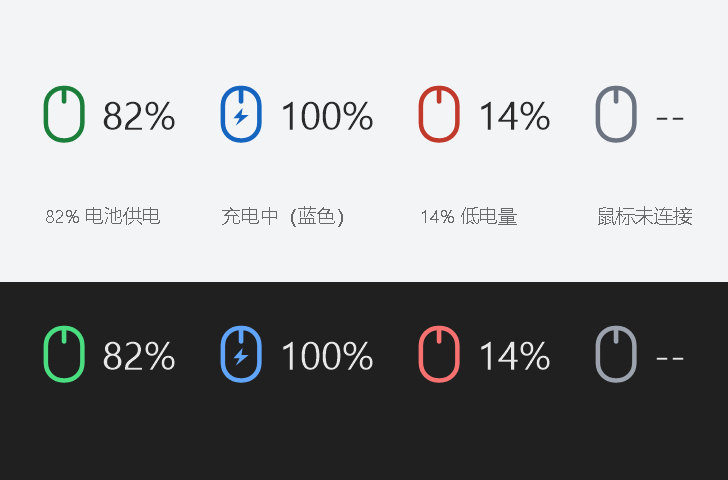

# Legion 鼠标电量（任务栏贴片）

在任务栏时钟左边显示一个**细线鼠标图标 + 电量百分比**，例如 `🖱 82%`。
没有任何底色方块、没有通知区图标、没有任务栏按钮，看起来就像系统自带的一小段状态。
.NET 10（Windows Forms + 少量 Win32），单进程、无第三方依赖。


各状态（浅色 / 深色任务栏）：



## 运行

双击 `BatteryTray.exe`。启动后：

* 任务栏 `^` 左边出现「鼠标图标 + 百分比」，高度约为任务栏的 48%，与托盘图标同高；
* 图标颜色即电量：**绿 ≥60%**、**橙 25–59%**、**红 <25%**、**蓝 + 机身里的小闪电 = 正在充电**、**灰 = 未连接（显示 `--`）**；
* 数字用系统墨色（浅色任务栏深灰、深色任务栏近白），跟随系统深浅色主题；
* **不建通知区图标**，也不会在任务栏多出程序按钮；
* 不进 Alt+Tab（`WS_EX_TOOLWINDOW`）；
* 每 60 秒刷新一次；左键点它立即刷新，右键出菜单（立即刷新 / 开机自动启动 / 退出）。

## 贴片是怎么贴上去的

两条路径，启动时自动二选一，日志里会写 `pill: mode=embed` 或 `mode=overlay`：

1. **embed（首选）**：先建顶层窗口，再 `SetParent(hwnd, FindWindow("Shell_TrayWnd"))`，成为任务栏的**子窗口**。
   它在任务栏内部，Z 序天然在任务栏之上、开始菜单之下，任务栏移动/自动隐藏时跟着走。
2. **overlay（兜底）**：系统拒绝跨进程 `SetParent`（返回 `err=5`）时退化成 `WS_EX_TOPMOST` 小窗口，
   位置自己算（贴在 `TrayNotifyWnd` 左边）。**不再每 500 ms 硬抬一次**（那会让贴片在点任务栏时闪一下），
   改成：平时完全不动，只有按 Z 序发现真的被别的窗口盖住时才 `SetWindowPos` 抬回来；
   同时用 `SetWinEventHook` 监听 `EVENT_SYSTEM_FOREGROUND` / `EVENT_OBJECT_REORDER`，
   在点任务栏的那一帧里就补回去，肉眼看不到闪烁。

贴片必须是**分层窗口**（`WS_EX_LAYERED`）+ `UpdateLayeredWindow` 提交 32 位预乘 ARGB 位图：
Windows 11 任务栏是 XAML 合成的，普通子窗口会被合成层盖住，只有分层窗口才有独立 DWM 合成面。
内容因此不走 `WM_PAINT`（只有分层失败时才退回常规绘制）。

explorer 重启会把任务栏窗口换掉，`TrayContext` 里 2 秒一次的看门狗会检测并重新挂载。

> 这套「SetParent + 分层 + UpdateLayeredWindow」的做法参考了 [VigilWatt](https://gitee.com/YGWG-LX/vigil-watt)
> 的任务栏嵌入迁移笔记。

### ⚠ 必须有 DPI 感知，否则贴片会跑到屏幕中间

启动第一件事调 `SetProcessDpiAwarenessContext(PER_MONITOR_AWARE_V2)`。
如果进程是 DPI-unaware，系统会按缩放比例（这台机器 150%）虚拟化坐标：
想要 `(2025,1547)`，窗口实际被打到 `(1336,1031)` —— 正好是屏幕中间，看起来就是"任务栏上什么都没有"。

启动日志里会有 `dpi: per-monitor`。看到 `unaware` 就是这个坑。

## 电量是怎么读出来的（关键）

**不是**只调一次 `HidD_GetFeature`。正确时序（逆向自 `LEGION EDGE.exe` 的 NeoUsb 模块）：

```
1. 构造 33 字节请求帧   [0]=0x0C  [1]=0x01  [2]=0x20   其余 0
2. HidD_SetFeature(h, req, 33)      ← 少了这一步，永远是 33 个 0x00
3. Sleep(100)
4. HidD_GetFeature(h, resp, 33)     ← resp[18] = 电量%，resp[19] = 充电标志
```

设备：`VID_17EF PID_61B7`，集合 `mi_01&col04`（UsagePage `0xFF00`, FeatureReportLength 33）。
响应帧形如：

```
0C 01 20 00 00 01 10 4D 36 30 33 30 01 00 95 25 01 FF 51 00 FF 01 00 00 6C 02 40 38 FF FF B1 16 01
                                                        ^^ [18]=0x51=81%   ^^ [19]=0 电池供电
```

**这条协议不依赖 LEGION EDGE 常驻**，卸载它之后照样能读（已实测）。
详见 `..\电量获取方法.md` 的 §2.8.1。

## 命令行

```powershell
.\BatteryTray.exe            # 正常启动（每 60 秒读一次电量）
.\BatteryTray.exe --interval 20   # 改成每 20 秒读一次（最小 5，最大 3600）
.\BatteryTray.exe --once     # 读一次电量，写 once.txt 并记日志（排查用）
.\BatteryTray.exe --icon     # 生成 strip_preview.png（各状态预览）
.\BatteryTray.exe --silent   # 不出任何提示框
```

## 占多少资源

本机实测（.NET 10 框架依赖发布，任务栏 150% 缩放）：

| 指标 | 数值 |
|---|---|
| CPU | **约 0.11% 的单核**（150 秒累计 172 ms，期间做了 10 次 HID 读取） |
| 私有内存 | **约 11 MB**（工作集 48 MB，其中大部分是 .NET 运行时共享页） |
| GDI / USER 对象 | 11 / 18，150 秒内**没有增长**（无泄漏） |
| 句柄 | 约 290，长时间运行稳定 |
| 线程 | 9 |

开销集中在两处，都很轻：

* **每 60 秒一次 HID `HidD_GetFeature`**（33 字节）——单次约几毫秒；
* **每 2 秒的看门狗**：只做一次 Z 序遍历（`GetTopWindow`/`GW_HWNDNEXT`）确认贴片还在、没被盖住，
  不重绘、不读设备；数值没变化时连 `UpdateLayeredWindow` 都不会调。

`SetWinEventHook` 只在前台窗口或 Z 序真的变化时才回调，空闲桌面下几乎不触发。

## 数据来源

`VID_17EF PID_61B7` 的 HID 集合 `mi_01&col04`（UsagePage `0xFF00`，FeatureReport 33 字节）。
读法**必须**是「先 `SetFeature` 请求、等 100ms、再 `GetFeature`」（见上文「电量是怎么读出来的」）：

```
请求: SetFeature(0C 01 20 00 … 00)  33 字节
响应: 0C 01 20 00 00 01 10 4D 36 30 33 30 01 00 95 25 01 FF 52 00 FF 01 00 01 6C 02 40 38 FF FF B1 16 01
                                              ^^^^ ^^^^
                                              [18] [19]
```

* `[18]` 电量百分比
* `[19]` 充电标志（`01` 充电中 / `00` 电池供电）
* `[7..11]` ASCII `M6030`，用来确认帧合法

**充电时设备会把 `[18]` 直接报成 100**（假值）。程序在充电时用上一次拔线读数显示，并把图标变蓝加闪电。
程序校验 `[2]==0x20 && [7..11]=="M6030"`，不合法就重试。

更深的协议（官方 SDK 的 `LNV_GetBattery`、520 字节特性通道、64 字节邮箱）见上一级 `电量获取方法.md`。

## 日志 / 排查

同目录 `BatteryTray.log` 每次启动追加：

```
11:35:34 === 启动 2026-10-19 11:35:34  pid=32064 64位=True 权限=Medium（普通用户权限） exe=… 自启项=注册表 Run 键
11:35:34 dpi: per-monitor
11:35:34 pill: SetParent 被拒绝 err=5，改用置顶小窗口
11:35:34 pill: render ulw=True mode=overlay 想要=(2025,1547) 47x34  实际=(2025,1547) 47x34
11:35:35 refresh: 电量 80% · 电池供电
```

* `权限=` 是进程完整性级别。**`Low` 说明它是被沙箱/受限方式启动的，注册表和启动文件夹都写不进去，
  任务栏也挂不上** —— 正常双击应该是 `Medium（普通用户权限）`；
* `dpi:` 必须是 `per-monitor`。若是 `unaware`，贴片会被画到屏幕中间（而不是任务栏），见上文说明；
* `想要=` 与 `实际=` 必须一致。不一致说明坐标被虚拟化了；
* `pill: render ulw=True` = 分层位图提交成功（`False` 会自动退回 `WM_PAINT` 绘制）；
* `pill: owner=taskbar|none` = 是否成功把自己的 owner 设成任务栏（成功时点任务栏也盖不住）；
* `pill: raise #n` = 真的被别的窗口压住、重新置顶过（最多记 3 条）；
* 如果你机器上是 `mode=embed`，说明真嵌进了任务栏，窗口位置随任务栏走。

程序起不来时会额外写 `crash.txt`（含完整异常），不会静默退出。

## 关于「双击时的 Windows 安全警告」

那个警告是 **SmartScreen**，原因是 exe **没有数字签名**（本机 `Get-AuthenticodeSignature` = `NotSigned`）。
它不影响功能，点「更多信息 → 仍要运行」即可。

三点说明：

* 本机 `SmartScreenEnabled = Off`，且这个 exe **没有 MOTW**（本地编译，不是从网上下载的），
  所以正常情况下**不应该**再弹；
* 只有「从网上下载来的、带 Zone.Identifier 的 exe」才会必弹；
* 自签名证书**消不掉**这个提示（那需要受信任的付费 EV 证书），所以没有做。

## ⚠ 绝对不要用「以管理员身份运行」

用管理员权限运行时，会**有进程但任务栏上看不到电量**。原因：

* 任务栏属于当前用户的 explorer（Medium 完整性）。管理员进程是 High，
  两者不在同一层，窗口贴不上去（`SetParent` 被 UIPI 拒绝），只能退化成置顶浮窗；
* 而且 explorer 的 DPI 感知和管理员进程不一致，坐标会被**再缩放一次**
  （实测 `y=1547` 被算成 `3075`，直接跑到屏幕外）；
* 管理员进程也不该往**用户**注册表里写自启项。

程序检测到提权会直接弹窗提示，日志里也会写 `权限: High（已提权…）  提权=True`。
**正常用法就是双击，不要右键选“以管理员身份运行”。**

（针对坐标二次缩放，代码里已经加了反向补偿 + 以任务栏实际矩形兜底，
所以即使误用管理员，窗口也会落回任务栏，只是仍可能压不住/盖在任务栏边缘。）

## 开机自启

菜单里的「开机自动启动」会依次尝试：

1. `HKCU\Software\Microsoft\Windows\CurrentVersion\Run`（同时写 `StartupApproved\Run` 标记，避免被 Win11 判成"已禁用"）；
2. 用户「启动」文件夹里的 **`LegionBatteryTray.lnk` 快捷方式**；
3. 两者都失败时：**在程序目录生成同一个 `.lnk` 并自动打开「启动」文件夹**，你拖进去即可（只需一次）。

> **不再使用 `.cmd`。** 早期版本往启动文件夹写批处理脚本，结果那个文件带上了
> “来自网络”标记（`ZoneId=3`），于是每次开机都弹
> **“打开文件 - 安全警告：无法验证发布者，你确定要运行此软件吗”**。
> 现在改用快捷方式 + 主动清除 MOTW，弹窗不会再出现。

程序每次启动还会顺手清一次自己的 MOTW（`AutoStart.UnblockFile`），一劳永逸。

### 如果自启还是写不进去

**先检查完整性标签**（本项目的高频坑）：

```cmd
icacls BatteryTray.exe
```

输出里有 `Mandatory Label\Low Mandatory Level` 就说明 exe 被打上了低完整性标签 ——
Windows 会因此把进程降权，`HKCU\...\Run` 和启动文件夹**都写不进去**。修复（需管理员，改标签是特权操作）：

```cmd
icacls "D:\dsh\LEGIONEDGE\BatteryTray\*" /setintegritylevel Medium /T
```

改标签是特权操作，需要管理员。以管理员身份打开终端，进入程序目录后执行：

```cmd
icacls "%CD%\*" /setintegritylevel Medium /T /C /Q
```

执行后再用 `icacls BatteryTray.exe` 确认输出里没有 `Low Mandatory Level` 即可。

### 关于那个“无法验证发布者”弹窗

它是 **MOTW（Mark-of-the-Web，文件带 `ZoneId=3`）** 触发的 “打开文件 - 安全警告”，
不是 SmartScreen 的“已保护你的电脑”。区分方法：标题里带 **“打开文件”** 三个字的就是前者。

触发条件是文件带 `Zone.Identifier` 备用数据流（通常来自“从网络下载 / 从压缩包解压”）。清除办法（任一）：

* 右键文件 → 属性 → 底部勾选 **“解除锁定”** → 确定；
* 命令行：`del "文件名:Zone.Identifier"`；
* 或 `Unblock-File -Path "文件名"`。

本程序改用 `.lnk` 且启动时自动 `UnblockFile`，所以不会再遇到。

每次勾选/取消都会把结果写进 `autostart_result.txt`，重启后可直接核对。
启动时 `TrayContext` 还会 `SelfHeal()`：之前勾过自启但找不到自启项的，自动补写一次。

## 右键菜单的行为与外观

自绘菜单（`PillMenu`），尺寸 **218×209**（150% 缩放下），圆角卡片、跟随深浅色主题。

### 两个必须踩过的坑

**① 一次右键只能创建一个菜单。**
一次右键会从三条路进来：贴片的 `WM_RBUTTONUP`、紧跟着的 `WM_CONTEXTMENU`、
以及贴片的 `WH_MOUSE_LL` 钩子（贴片被任务栏压住时靠它兜底）。
不去重的话一次右键连开 3 个菜单（实测日志同一毫秒 3 次 `menu: 打开`），
后面的会把前面的销毁重建 —— 于是按钮点不动（点在建/毁间隙）、也不自动关闭（关闭钩子被反复卸载重装）。
`ShowMenu()` 里用 400ms 去重解决。

**② `WS_EX_NOACTIVATE` 的窗口默认会吞掉第一次点击。**
`WM_MOUSEACTIVATE` 默认返回 `MA_ACTIVATE`，而窗口又不能激活，
结果这次点击被当作"激活点击"消费掉 —— 表现就是"点按钮没反应"。
显式返回 `MA_NOACTIVATE` 让点击直接投递进来。

注意这个样式**必须在 `CreateWindowEx` 时就带上**，只定义常量、只靠 `MA_NOACTIVATE` 兜底是不够的：
少了它，窗口仍然可以被系统提为前台（比如菜单弹出期间原前台窗口恰好关闭），
"菜单永远不会成为前台窗口"这个自动关闭前提就不成立。

**自动关闭**——三条独立机制叠加，任意一条生效即可，避免"点别处菜单不关"：

| 触发 | 机制 |
|---|---|
| 菜单外按下鼠标左/右键 | `WH_MOUSE_LL` 低层钩子（按下即判定，不漏快速点击） |
| 光标进过菜单后再移开 > 0.8s | 30ms 轮询 `GetCursorPos`（"移开即失焦"） |
| 前台窗口换成别的程序 | 30ms 轮询 `GetForegroundWindow` 对比弹出时的前台窗口 |
| Esc | 30ms 轮询 `GetAsyncKeyState(VK_ESCAPE)`（菜单没有键盘焦点，收不到 `WM_KEYDOWN`） |

为什么要三条：钩子在某些安全策略下装不上；`GetAsyncKeyState` 在个别受限环境可能读不到；
轮询会漏掉极快的点击。三者互不依赖，保证菜单**一定**会关。

只有"光标曾进入菜单"之后才开始计离开时间 —— 因为菜单是在贴片**上方**展开的，
刚弹出时鼠标还停在贴片上（位于菜单外），直接计时会把还没移进去的菜单关掉。

**能点的**：电量/状态两行是只读的（灰色），其余四项可点；悬停有高亮，勾选项左侧有对勾。

## 全屏时自动隐藏

看视频、玩游戏、做 PPT 放映时，贴片会自动消失，不挡画面；退出全屏 500ms 内恢复。

判定（`FullScreen.cs`），必须同时满足：

1. 前台窗口不是外壳/系统 UI —— 按窗口类（`Progman`/`WorkerW`/`Shell_TrayWnd`/`StartMenuExperienceHost` 等）
   和进程名（`explorer`/`SearchHost`/`TextInputHost` 等）双重过滤；
2. 前台窗口**不是最大化**（`IsZoomed` 或 `WS_MAXIMIZE`）—— 最大化保留了标题栏，属于正常用桌面；
3. 前台窗口矩形**铺满**它所在显示器的 `rcMonitor`（容差 2px）。

### 为什么不用"任务栏被盖住"来判断

实测（`tools/FullScreenProbeProj`）：普通 `WS_POPUP` 顶层窗口即使铺满 2560×1600，
任务栏依然显示在最上面 —— 任务栏本身是 topmost 且 Z 序更靠前。
只有 DirectX **独占全屏**才会真的顶掉任务栏。

而日常"全屏"（浏览器全屏视频、YouTube、PPT 放映）都是无边框窗口，**任务栏还在**，
但这恰恰是用户希望隐藏贴片的场景。所以判据只落到"前台窗口是否铺满显示器"。

### 隐藏方式

`ShowWindow(SW_HIDE)` + `SetWindowPos(-32000,-32000)` 双保险。
实测只调 `SW_HIDE` 时，分层窗口（`WS_EX_LAYERED` + `UpdateLayeredWindow`）
的 `IsWindowVisible` 不一定立刻翻转，画面也可能残留一帧；移出屏幕能立刻从合成面消失。

恢复时重置布局缓存并重新 `Render()` —— 隐藏期间 DWM 表面可能失效，必须重提交位图。

## 日志：每次启动清空

`Program.Main` 第一行调用 `TrayContext.ResetLog()`，删掉上一次的 `BatteryTray.log`，
之后只在本次运行内追加。这样每次排查看到的都是干净的一次运行记录。

（原先"超过 256KB 自动整体清掉"的逻辑已移除，不再需要。）
## 为什么右键菜单不在任务栏留窗口

本进程**没有"主窗口"**（贴片是 `WS_EX_TOOLWINDOW` 的顶层窗口，不算主窗口）。
WinForms 弹出的 `ContextMenuStrip` 是一个**无 owner 的顶层窗口**，
Windows 的规则是"任务栏只列无 owner 的顶层窗口"，于是菜单一弹就多出一个任务栏按钮。

实测（`WinLs` 探针）：

```
修复前  菜单窗 parent=0  owner=-             ← 上任务栏
修复后  菜单窗 parent=…  owner=贴片窗口        ← 不再出现
        SysShadow 阴影窗也一样拿到 owner
```

做法：`ShowMenu()` 弹出后立刻把菜单窗口（含弹出子菜单和 `SysShadow` 阴影窗）的
`GWLP_HWNDPARENT` 设成贴片窗口自身。**有 owner 的窗口不会出现在任务栏**，
贴片本身又是 TOOLWINDOW，所以整条链路都不会产生任务栏按钮。

## 开关开机自启：完全不弹任何窗口

历史教训（都被实测否掉了）：

1. `MessageBox` —— 抢焦点，自己也是个窗口，会在任务栏短暂出现；
2. 贴片旁的小气泡（自绘 `Form`）—— 在某些机器上**渲染不出来，只有一块黑底，还会卡住**。

现在彻底不用任何临时窗口：

| 操作 | 界面反馈 |
|---|---|
| 开启自启成功 | 菜单里「开机自动启动」那行右侧出现「已开启」 |
| 关闭自启成功 | 该行的「已开启」消失 |
| 失败 | 界面无变化，细节写进 `autostart_result.txt` 和 `BatteryTray.log` |

`TaskbarPill.ShowBalloon` 已整个删除，代码里不再有任何弹窗路径。


本程序是**框架依赖（framework-dependent）**发布，需要
`Microsoft.WindowsDesktop.App 10.x`（x64）。本机装有 `10.0.15`，所以能跑。

### 这个目录必须四个文件一起走

```
BatteryTray.exe
BatteryTray.dll                 ← 真正的主程序
BatteryTray.runtimeconfig.json  ← 告诉 host 用哪个 .NET
BatteryTray.deps.json           ← 依赖清单
```

**只复制 `BatteryTray.exe` 是不行的。** 实测几种「复制不全」的真实报错：

| 少了什么 | 实际报错 |
|---|---|
| 只复制 exe | `The application to execute does not exist: '...\BatteryTray.dll'` |
| 少 `runtimeconfig.json` | `The library 'hostpolicy.dll' ... was not found` + `Failed to run as a self-contained app` |
| 版本号对不上 | **`You must install or update .NET to run this application.`** |

最后那条就是"我明明装了 .NET 8 却说没装"最常见的原因 —— 它其实**不是说没装 8.0**，
而是说"找不到 runtimeconfig 里要求的那个具体版本"。看它列出的 `The following frameworks were found:`
就知道机器上实际有什么。

### 已做的兼容处理

`BatteryTray.csproj` 里设了：

```xml
<RollForward>Major</RollForward>
```

生成的 `runtimeconfig.json` 里会多一行 `"rollForward": "Major"`。效果：

* 有 8.x → 用 8.x（正常路径）；
* 8.x 被卸载/损坏、只剩 10.x → **自动用 10.x 跑**（本机同时装了 `8.0.28` 和 `10.0.10`，已验证可运行）；
* 只有更低版本 → 仍然明确报错，不会悄悄跑出怪问题。

### 想完全不依赖已安装的 .NET

用自包含发布（会把 ~70 MB 运行时打进单文件）：

```powershell
dotnet publish -c Release -r win-x64 --self-contained true `
  -p:PublishSingleFile=true -p:IncludeNativeLibrariesForSelfExtract=true `
  -p:EnableCompressionInSingleFile=true -o publish
```

> 注意：这条命令**需要联网**（要下载 `Microsoft.NETCore.App.Runtime.win-x64` 等运行时包）。
> 当前离线状态下做不出来，所以当前交付的是框架依赖版 + `RollForward`。

### 自查工具

在程序目录打开终端，依次执行下面几条来确认环境：

```cmd
where dotnet                  :: 1. dotnet 在不在 PATH
dotnet --list-runtimes        :: 2. 实际装了哪些运行时
echo %PROCESSOR_ARCHITECTURE% :: 3. 系统架构（需 x64；x86 运行时跑不了 x64 程序）
dir BatteryTray.*             :: 4. 四个文件是否齐全
type BatteryTray.runtimeconfig.json  :: 5. 有没有 rollForward
```

其中第 3 步要看到 `AMD64`；第 5 步要看到 `rollForward`（否则只装了 .NET 9/10 时会启动失败）。

## 依赖 / 为什么「装了 .NET 还说没装」

（本程序是框架依赖发布，需要 Microsoft.WindowsDesktop.App 10.x；

## 自己编译

```powershell
# 使用系统安装的 .NET 10 SDK（10.0.404）
$env:DOTNET_ROOT='C:\Program Files\dotnet'
$env:DOTNET_CLI_HOME='D:\dsh\LEGIONEDGE\dotnet-home'
$env:APPDATA='D:\dsh\LEGIONEDGE\dotnet-home\appdata'      # 沙箱里不能写默认 NuGet 目录
$env:NUGET_PACKAGES='D:\dsh\LEGIONEDGE\dotnet-home\packages'
cd D:\dsh\LEGIONEDGE\BatteryTrayNet
& 'C:\Program Files\dotnet\dotnet.exe' build -c Release
```

## 代码审查后修掉的问题（本轮）

对全部源码做了一遍审计，修了 1 个高危性能问题、5 个高危/中危正确性问题和若干健壮性瑕疵。

| 级别 | 问题 | 后果 | 修法 |
|---|---|---|---|
| 高 | **电量读取跑在 UI 线程** | `Hid.ReadOne` 失败路径是 `Sleep(100)+Sleep(150)` ×4 次 ×多设备，拔掉接收器后每次刷新卡界面 1 秒以上，贴片/菜单/钩子全停 | 读取挪到 `Task.Run`，结果经 `SynchronizationContext` 回 UI 线程；加防重入 |
| 高 | **`WM_PAINT` 死循环** | 兜底绘制用 `GetDC` 却不 `ValidateRect`，一旦分层提交失败就无限重绘刷 CPU | 改用 `BeginPaint/EndPaint` |
| 高 | **`Instances` 字典加锁不一致** | 钩子线程枚举、UI 线程增删，可能抛 `InvalidOperationException` 在钩子回调里 | 所有访问点统一 `lock` |
| 高 | **一次点击触发两次** | 钩子 `Invoke` 后又放行，窗口再收到一次；右键连开两个菜单、左键读两遍电量 | 钩子只 `PostMessage`，`WndProc` 单点分发 + 300ms 去重 |
| 高 | **菜单缺 `WS_EX_NOACTIVATE`** | 常量定义了、注释都写着，但 `CreateWindowEx` 没传，自动关闭的前提不成立 | 创建时带上该样式 |
| 中 | **贴片抢焦点** | `WM_MOUSEACTIVATE` 返回 `MA_ACTIVATE` 且没带 `WS_EX_NOACTIVATE`，点贴片会把焦点从当前程序抢走 | 两处都改（4 行） |
| 中 | **菜单关闭后钩子不摘** | 三条正常关闭路径都留着全局鼠标钩子，直到下次开菜单 | `Close()` 开头 `StopAutoClose()` |
| 中 | **菜单动作跑在线程池** | 动作里 `DestroyWindow` 跨线程静默失败，退出时贴片窗口可能残留 | 改为投回 UI 线程执行 |
| 中 | **多屏/任务栏在上方时菜单错位** | 固定用主屏边界钳制，副屏任务栏上弹菜单会被拽回主屏 | 改用 `Screen.FromPoint` + 四边钳制 |
| 中 | **自启项不带 `--silent`** | 开机启动若早期崩溃会弹窗，违反零弹窗 | Run 值/快捷方式加 `--silent`，启动时自动给旧值补上 |
| 中 | **断连时充电状态不重置** | 菜单同时显示"鼠标未连接"和"充电中" | 断连分支清 `_charging` |
| 中 | **单实例可被 exe 改名绕过** | 按进程名查不到真实例 → 误判僵尸 → 双开 | 按可执行文件路径比对 |
| 低 | 日志无限增长 | `BatteryTray.log` 会一直长 | 超过 256KB 自动清空；watchdog 只在状态变化时记一行 |
| 低 | 全局钩子不卸载 / `ReleaseMutex` 必抛 / `GetInt` 无保护 / COM 未释放 / `--interval` 静默忽略 / 创建失败无退避等 | —— | 逐项修掉 |

> 有一条审查建议**没有采纳**：给 `Hid.IsValid` 补校验响应帧 `[3]==0x00`。
> 实测正常帧里这一位**并不固定**，先后抓到过 `0C 01 20 02 …` 和 `0C 01 20 00 …` 两种，
> 加了这一位会把其中一种正常帧判死、直接读不到电量。协议注释已按实测订正。

回归验证：菜单连续开关 **5/5 打开、5/5 关闭**；点击「立即刷新」菜单关闭且动作在 UI 线程执行；
启动无崩溃，贴片渲染与电量读取正常。

## 第二轮复审又修掉的问题

对修复后的代码再过了一遍，上一轮修复全部验证通过，另发现 4 个真问题（无新高危）：

| 级别 | 问题 | 后果 | 修法 |
|---|---|---|---|
| 中 | 单实例改名防护自相矛盾 | `GetProcessesByName("BatteryTray")` 先按进程名过滤，exe 改名后真实例被筛掉 → 误判僵尸 → 双开 | 改为全量枚举进程 + 按可执行文件路径比对 |
| 中 | 读取异常分支漏调 `Apply()` | HID 读取抛异常时贴片仍显示上一次的旧电量，不变成"未连接" | error 分支补 `Apply()` |
| 中 | 钩子回调里写文件日志 | LL 钩子有 300ms 系统超时，磁盘卡顿时钩子被**静默摘掉**，点击彻底失灵 | 回调里删日志，`PostMessage` 失败才记一条 |
| 中 | 菜单开着时右键贴片"关了旧没开新" | 菜单的自动关闭钩子在 `RBUTTONDOWN` 关掉旧菜单，`ShowMenu` 的 400ms 防抖又拦住新菜单 → 右键看似没反应 | `ShowMenu` 防抖区分"菜单是否开着"，开着时直接重建不走防抖 |
| 低 | `OnForegroundChange` 无锁读 `Instances.Count` | 与统一加锁目标不一致（实际风险极小） | 删掉，lock 内取空数组直接返回 |
| 低 | `PillMenu.StartAutoClose` 空 `else` 死代码 | —— | 删除 |
| 低 | Quit 后到达的延迟 `Post` 碰已 Dispose 的贴片 | 退出瞬间可能抛 `ObjectDisposedException`（仅日志噪音） | 加 `_quitting` 标志，退出后丢弃 |

回归验证同样通过：菜单 5/5 开合、菜单项点击、无崩溃。


